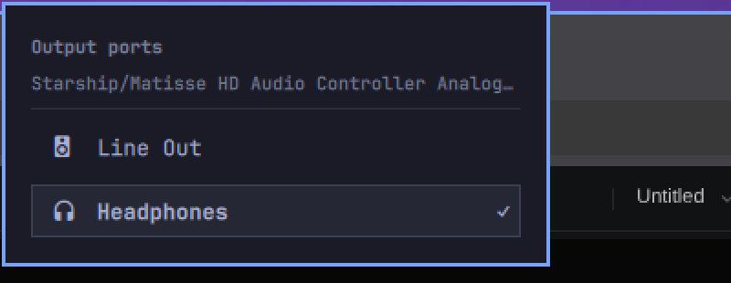

# Tek Audio Ports

An Omarchy shell plugin that puts the **output port** of your current sound
device in the bar — rear line-out, front headphones, HDMI — and switches it in
two clicks. Omarchy's audio panel lists sinks, not ports, so on a codec that
exposes one analog sink with several physical jacks (the Realtek ALC892 is the
reference here) there was no way to choose the jack without editing login
scripts. This widget makes that choice visible, one click away, and leaves
volume, mute and per-app mixing where they belong: `omarchy.audio`.



## Install

```sh
omarchy plugin add https://github.com/erwinpagulong/omatek-audio-ports.git --enable
```

## Usage

- **Left click** the glyph opens the port list for the current output.
- **Right click** cycles to the next available port without opening the panel.
- In the panel: `j`/`k` or `↑`/`↓` move the cursor, `Enter`/`Space` switches,
  `Esc` closes, `Tab` moves to the neighbouring panel. Clicking a row switches
  to it and closes the panel.
- The glyph follows the active port: headphones, an HDMI display, or speakers.

Ports reported as `not available` (no cable in the jack) are dimmed, labelled
`not plugged in`, and cannot be selected.

## What it touches

| | |
|---|---|
| `pactl get-default-sink`, `pactl -f json list sinks` | read the default sink and its ports |
| `pactl set-sink-port <sink> <port>` | the only write; switches the active port |
| `pactl subscribe` | one long-running process, debounced 120 ms, restarted 2 s after it exits |
| `omarchy-audio-output-sink` | read-only fallback when the default sink is a virtual/DSP sink with no ports |
| `~/.config/omarchy/audio-output-port` | best-effort one-line record of the chosen port |

No shell scripts, no `sudo`, no install hooks, no second Quickshell process, and
nothing under `/usr/share/omarchy/` is modified.

## Supported environments

Any PipeWire or PulseAudio sink that exposes more than one entry in `ports[]`.
That covers analog jacks, HDMI outputs, laptop speakers vs. headphone jacks and
most USB audio interfaces. The choice is also stored by WirePlumber in
`~/.local/state/wireplumber/default-routes`, so it normally survives reboot on
its own; the preference file above lets login/resume helpers honour it too.

## Limitations

- **No "both jacks at once" mode.** A port is a single PipeWire route; playing
  rear and front simultaneously is a mixer trick this plugin does not do.
- A virtual DSP default (for example `easyeffects_sink`) with no ports falls
  back once to the physical output that `omarchy-audio-output-sink` resolves.
  If that also has no ports, the glyph still shows the device class and the
  panel says there is nothing to switch.
- A sink with exactly one port stays visible and says
  `This output offers only one port.` — hiding it would shift the whole bar
  whenever the default output changed.

## Remove

```sh
omarchy plugin remove io.github.erwinpagulong.omatek-audio-ports
```

## License

MIT — see [LICENSE](LICENSE).
